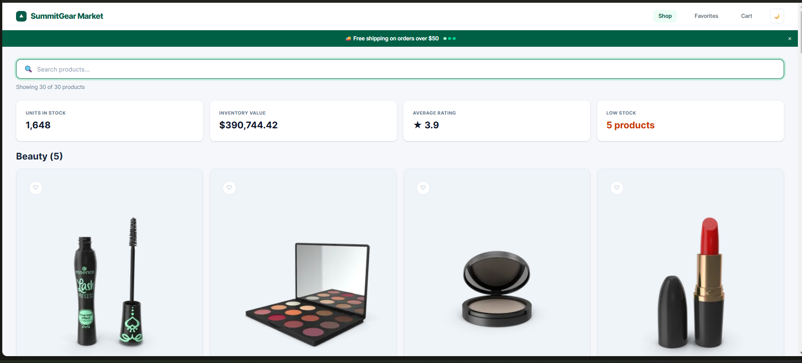

# SummitGear Market

A responsive online storefront for a fictional outdoor-gear company, built with **React, TypeScript and Tailwind CSS**. Browse products fetched from a live API, search and favourite items, manage a persistent cart, and walk through a multi-step checkout to a fake order confirmation.

**Live site:** https://meek-sprite-b1e672.netlify.app/


> This project was built ticket-by-ticket as part of a frontend work simulation, growing from a single product card into a full storefront with routing, global state and a checkout flow.

## Features

**Browsing**
- Products loaded from the [DummyJSON](https://dummyjson.com/docs/products) API, with a loading skeleton and an error state with a retry button
- Live search by product title, with a "no products found" empty state
- Products grouped into category sections, plus an inventory stats bar (units in stock, inventory value, average rating, low-stock count)
- "Low Stock" badges on products running low
- Product detail pages at `/products/:id`, with a friendly "product not found" message for bad IDs
- Custom 404 page for unknown routes

**Personalisation**
- Favourite products, with a dedicated favourites page
- Light and dark mode toggle
- Favourites, theme and cart all persist across page reloads (saved to `localStorage`)

**Cart and checkout**
- Add to cart with quantity controls; quantities are capped at available stock
- Cart item count shown in the browser tab title
- Dismissible, rotating promo banner
- Three-step checkout (**Shipping → Payment → Review**) with a progress indicator
  - Field validation on every step (required fields, 16-digit card number, `MM/YY` expiry that must not be in the past)
  - Going back keeps what you typed
- **Place order** generates a fake order number, clears the cart, and shows a confirmation page with the items and total
- Visiting the confirmation page directly with no order redirects home

> Payments are simulated. No real card data is collected or sent anywhere.

## Tech Stack

| Area | Tools |
|---|---|
| Framework | React 19 + TypeScript |
| Build tool | Vite |
| Styling | Tailwind CSS v4 |
| Routing | React Router v7 |
| State management | Zustand (with `persist` middleware) |
| Icons | Iconify |
| Linting | oxlint |
| Data | DummyJSON REST API |

## Running Locally

You'll need [Node.js](https://nodejs.org/) (a recent LTS version) and npm.

```bash
# 1. Clone the repo
git clone https://github.com/YOUR-GITHUB-USERNAME/YOUR-REPO-NAME.git
cd YOUR-REPO-NAME

# 2. Install dependencies
npm install

# 3. Start the dev server
npm run dev
```

Then open the URL printed in the terminal (usually http://localhost:5173).

### Other scripts

| Command | What it does |
|---|---|
| `npm run build` | Type-checks with `tsc` and creates a production build in `dist/` |
| `npm run preview` | Serves the production build locally |
| `npm run lint` | Runs oxlint |

## Project Structure

```
src/
  components/   UI components and route pages (cart, checkout, product detail, etc.)
  store/        Zustand stores: cart + checkout info, favourites, theme
  types/        Shared TypeScript types (Product, CartItem)
  utils/        Helpers such as groupByCategory
  data/         Local sample product data
  App.tsx       Data fetching and route definitions
  main.tsx      App entry point
tickets/        The original project tickets this app was built from
```

## What I Learned

- Typing component props and shared data models with TypeScript
- Using `.filter`, `.map` and `.reduce` to derive UI (search results, category groups, stats, cart totals)
- Managing global state with Zustand and persisting it to `localStorage`
- Client-side routing with React Router, including passing data between routes
- Fetching data with loading and error states
- Building and validating a multi-step form

## Credits

Product data and images from [DummyJSON](https://dummyjson.com/).
